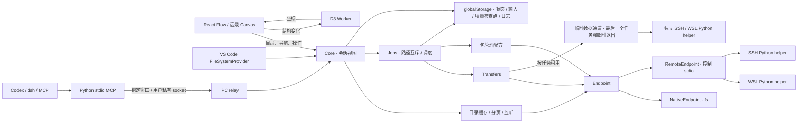
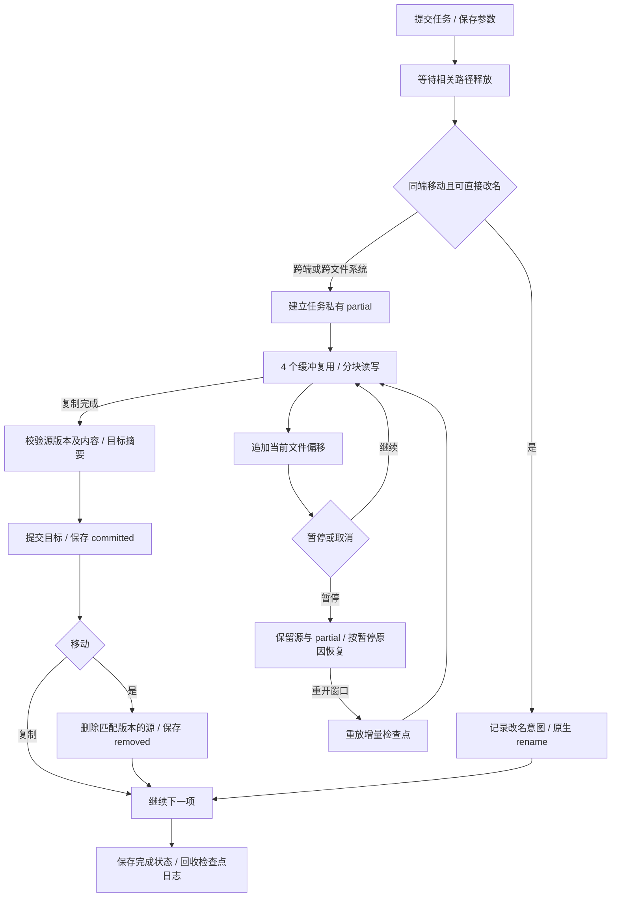
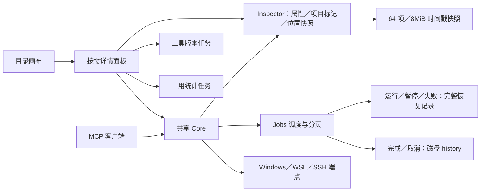
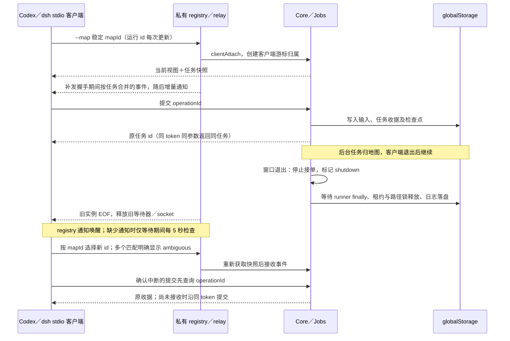
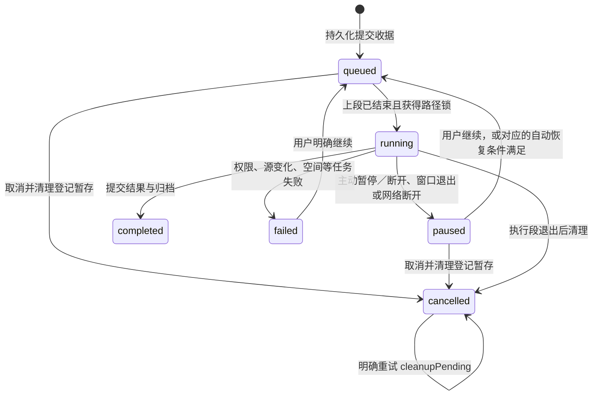
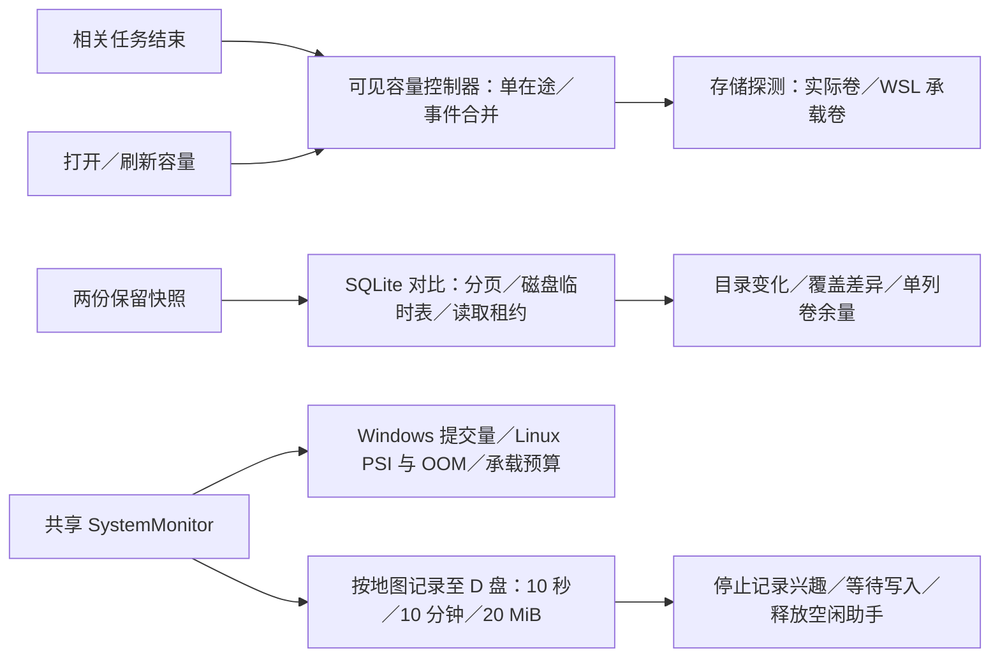
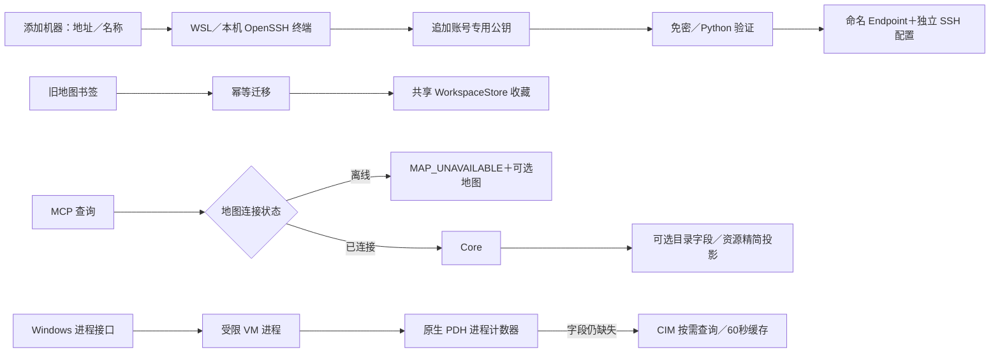

# Workspace Map 代码与数据流

Windows UI Extension Host 持有 Core；磁盘读写使用 Node 原生文件接口。WSL 和 SSH 使用按连接启动的 Python stdio 助手；SSH 连接可复用所选 WSL 环境的 OpenSSH 配置。产品代码以端点配置提供主机、账号和根路径。

- `src/core/core.ts` 是界面和 Agent 的公共入口；视图、跟随、导航历史由这里维护。目录、任务及 UI 的状态通知独立。
- `src/core/directories.ts` 保存有界的已知结构，画布游标独立于 Agent／编辑器。收起释放画布游标；缓存保留时间戳。监听只覆盖可见分支和编辑器保留的目录。画布可见性由 Extension Host 维护；隐藏后迟到的 watch 消息继续受可见性约束，编辑器监听独立保留。分页回复交回之前核对请求归属，已收起或被替换的请求关闭游标。
- `src/adapters/native.ts` 与 `helpers/endpoint.py` 保留文件、目录、链接、特殊节点、无权限结果的身份。游标包含页序号，重复读取最近一页返回同页；客户端之间的扫描相互独立。
- `src/core/jobs.ts` 持有任务生命周期与重叠路径互斥。参数一次写入，检查点按变更键追加；状态文件原子替换。旧版整份任务记录仍可读取；0.3.0 在 v2 元数据结构中保存 operationId、暂停原因及 lifecycleVersion。
- `src/packages/` 将具体生态能力转成 argv。包命令的 stdin 与助手协议隔离；输出、取消、退出状态由执行端管理。Windows 命令包装器通过 cross-spawn 处理。
- `src/ui/` 在结构变化时请求布局；任务进度、镜头移动使用各自更新通道。缩小至远景后切换 Canvas，放大恢复完整文件控件。文件手柄与画布平移分别处理。
- `src/mcp/` 负责窗口会话、IPC 与配置接入。MCP 交接任务 ID，计算与传输继续在 Core 执行。

## 复制、移动与恢复

文件内容校验与源删除分开记录。已提交目标的移动在恢复时重新核对目标，保留发生变化的源。原生改名完成但确认中断时，以文件身份核对目的位置。目录同名覆盖采用合并；额外目标条目保留。覆盖／跳过策略锁定具体目标路径，互不重叠的文件可以并行；自动改名仍持有目标目录锁，覆盖其可能选择的同级名称。路径错误、离线、包命令失败由对应任务或分支呈现，画布继续接受操作。

关闭窗口停止接单与监听，等待执行段 finally、任务日志和检查点，再关闭助手。旧连接退出事件只处理该连接的请求；已断开的对象拒绝后续调用，重新连接创建新对象。包进程拥有独立进程组，取消后收集实际退出结果。目录和操作权限始终来自端点账号。

## Profiling 的归属

Extension Host 的 CPU／RSS 是共享进程数据，日志显式标记 `shared-extension-host`；插件自身基准另外记录进程差值。Webview 记录 JS heap、长任务、布局耗时，验收通过 CDP 测渲染进程 CPU、DOM 和帧间隔。远端记录助手自身 RSS、峰值、CPU 时间及游标／子进程数。原始数据与条件见 PERFORMANCE。

目录失效立即清除数据缓存，在 150ms 固定窗口内按分支合并通知；读取中收到的刷新请求在当前读取结束后补一次，收起的分支释放该刷新。原生目录属性每批并发 16 项；原生游标空闲 120 秒后由活动游标维护定时器清理，游标归零后停止定时器。画布离屏缓存同时限制为 128 个分支、16,000 条目录项，当前可见分支继续保留。

`map_diagnostics` 读取内存计数，独立于文件扫描；SSH／WSL 的 `map_resources.transport` 记录控制通道的序列化、解析、发送／接收字节、RPC 累计耗时及待处理数量；`transfer` 返回活动数据助手资源，`lastTransferTransport` 保留刚关闭的数据通道计数。RPC 累计时间包含并行等待，用于分析调用开销；报告中的任务墙钟时间另外记录。包进程资源按 helper 管理的直接子进程采样，Linux 返回 PID、RSS 和 CPU；Windows 返回 PID 与退出状态，由验收进程采样器补充进程资源。

文件传输通过 `Endpoint.openTransfer()` 租用数据通道，同一端点的并行任务共享该通道；每个任务在 `finally` 释放租约，计数归零后助手退出。目录、编辑器和包任务继续使用控制通道。端内移动优先保留原有直接改名路径；跨端传输及复制使用独立数据通道。断开端点会同时关闭两条通道。默认两个并行传输任务，各端的数据助手按需启动；空闲端点维持原有控制连接。

单目录中已枚举为普通文件且大小至多 256 KiB 的条目，最多四个并行处理。目录、链接、大文件以及恢复的旧清单沿顺序路径处理；目标别名冲突先排空当前批次。任务共用四块 1 MiB 缓冲，分块读写结束即归还；每个文件继续独立校验与记录提交进度。批次失败等待已启动项收束，完成项留在任务记录中。

## 日常管理与归档（0.2.0）

- `src/core/inspect.ts` 只按用户请求检查当前目录内固定名称的清单、锁文件和环境目录，保留软链接身份。项目登记是地图元数据，保存于 `inspect.json`；文件内容沿用原端点。工具发现按端点与 cwd 合并进行中的请求，版本清单复用现有 exec 进程生命周期。版本查询、项目环境和占用结果带时间戳；手动刷新更新快照。已知缓存位置逐个验证存在，管理器自定义位置从包管理命令查询。
- `DetailPanel`、`TaskPanel` 独立挂载，共用 `rpc.ts` 的引用计数任务订阅。面板关闭撤销订阅，画布隐藏清除宿主订阅；文件编辑器和目录监听保持各自生命周期。资源查询由按钮发起，无新增待机采样循环。关闭面板后已提交的后台统计／传输继续运行，可在任务面板取消。
- 快照同时限制数量与序列化体积，持久写入合并排队请求。文件修改使所属端点的快照失效；再次查询按需重建。目录浏览、任务调度与缓存清理各有独立入口。
- `Jobs.page` 返回全部运行／可恢复摘要及最多 200 条历史摘要；UI 每页 30 条，只保留当前页。历史游标使用创建时间与 ID；每次查询仅保留本页候选文件名。历史正文、输入、结果、日志在详情请求时读取。内存保留最近 100 个结束任务以兼容现有同步 `get` 调用；完整归档存于 `jobs/history`。旧版 flat journal 首次启动迁移，旧输入／结果／日志原位保留。暂停与失败继续沿原恢复流程。
- 新增 MCP 工具 `map_inspect`、`map_projects`、`map_registerProject`、`map_inventory`、`map_jobsPage`；原 `map_jobs` 保留数组形态，返回可恢复任务及有界近期摘要。批量历史使用新分页入口。

## 发布与多窗口版本

`.github/workflows/check.yml` 对 PR 做 Linux 全套与 Windows portable 检查；`release.yml` 在 `v*` 标签上检查版本、构建 VSIX 并发布摘要和元数据。`scripts/release-assets.mjs` 从实际 VSIX 计算 SHA-256，和源码提交一起写入 release.json。安装、配置、升级、回退与实机范围见 `docs/RELEASE.md`、`docs/ACCEPTANCE.md`。

MCP 客户端助手按 mcp.py＋tools.json 的内容哈希写入 `~/.local/share/workspace-map/client/<revision>`。新旧 VS Code 窗口使用各自固定助手目录，接入命令仅更新本扩展项；已配置的旧客户端继续使用其原目录与授权。后台任务共享 Core，窗口会话通过 session ID 绑定。profiling 包含工具版本命令的 endpoint、cwd、名称、耗时及退出状态。

工具发现位于 `src/packages/discovery.ts`，依赖端点与原生路径；UI 共用的 `catalog.ts` 只包含命令配方与字段声明。项目登记与移除属于地图元数据，移除操作独立于端点连接状态。

## Agent resume 与资源生命周期（0.3.0）

- `mapId` 使用窗口已有的 `mapStorageId`；relay 的 `id` 和记录令牌表示本次运行。窗口 owner 记录以令牌命名，退出只删除自身文件。会话记录包含 mapId、运行状态与 token；同名地图按身份选择。
- MCP 每进程保持一个恢复线程、一个订阅／请求复用 socket。Linux 使用 inotify 监听注册目录，连接期间阻塞等待 socket 数据；fallback 仅等待连接期间每 5 秒检查。重绑递增 generation，关闭旧 socket，使旧 pending 请求结束；读回复前复核 generation。EOF 关闭连接、watch FD、等待器与线程池。
- relay 为每个客户端建立有界写队列，慢客户端断线后重新取快照；握手期间事件按任务合并，快照先入队，随后发出积累事件。目录游标跟随 relay 客户端身份，解绑及退出关闭本客户端游标；目录的迟到回复核对同一归属对象后交回。
- Core 提交先按 operationId 的 SHA-256 定位任务，按规范化参数指纹核对重复调用；活动记录和 history 共同承接收据；operations 中的定长定位记录直接找到归档位置，新增提交沿固定路径查询，历史数量与查询开销分离。任务元数据先持久化再执行；提交回复等待记录写入。客户端确认丢失时先查 `map_operation`，原任务继续运行。包命令沿同一收据返回实际结果，重新执行使用新 operationId。
- lifecycleVersion=1 的窗口／进程中断传输在启动时接续；网络断线用 `TransportLost` 分支暂停，只对这类任务安排单个恢复等待器并检查所需端点，间隔从 1 秒收敛到 30 秒。主动暂停、主动断开、取消及缺少原因的旧记录分别保留原意。重新执行继续使用既有内容核对、检查点和路径锁。
- Transfers 在 finally 归还任务租约及借出的缓冲，Jobs 随后释放路径锁并落盘。取消沿登记的 uncommitted 私有路径清理，保留已提交目标及源处理事实；失败项写入 cleanupPending，归档后仍可通过 `map_jobCleanup` 或任务面板明确重试。
- `lifecycle.ts` 集中 1.5 秒宽限；Core、Jobs、Endpoint、Bridge 的关闭均可重复等待。宽限结束中止归属进程与悬挂 RPC，再等待 finally 和记录写入；Native 包进程的升级 kill 定时器在进程结束时回收。视图写入串行，关闭时交接最终快照。
- `map_diagnostics` 增加 Agent 客户端／订阅／pending、客户端游标、runner、日志写入、恢复等待器、传输租约／缓冲及退出阶段；`map_connection` 返回客户端绑定、恢复状态和最新交接快照。编辑器与面板继续各自管理订阅，后台任务使用地图生命周期。

0.2.0 助手的独立请求 socket 继续沿旧分页方式工作；新助手通过 clientAttach 声明连接归属，采用完整的恢复与退出流程。升级接入命令生成稳定 mapId 绑定。目录关闭调用和退休端点均有归属集合，地图退出在助手收束后等待这些清理完成。Python helper 的 stdin EOF 结束其控制权；清理所属包进程、游标与监听后退出，即使某个 worker 仍阻塞于系统调用。

## 侧边栏与按键入口（0.3.1）

`src/sidebar.ts` 提供原生 TreeView，机器来自 Endpoint 配置，书签来自 ViewState，操作通过已注册命令进入。侧边栏仅读取内存元数据；地图继续在原编辑区 Webview 中运行，沿用唯一 Core、目录缓存与监听归属。隐藏时标记待刷新，重新显示再通知 TreeView；端点和书签变化触发更新，释放视图时撤销事件监听。

按键和侧边栏共用 extension.ts 的导航与界面命令。导航先更新 Core，再显示地图；搜索、任务和定位消息在 Webview bootstrap 回复后交接。隐藏或关闭地图重置 ready 状态，重新打开时继续交接待执行的界面操作。后台任务和 Agent 恢复沿原生命周期。

## 四端系统资源（0.4.0）

SystemMonitor 在原有 Core 下管理独立资源通道；资源页、MCP 共享机器快照，记录拥有独立订阅生命周期。Windows 多盘符合并，Python stdio 采集器通过 NVML、WinAPI／DXGI／PDH 或 /proc 读取资源。采集与目录控制／传输数据通道分离，页面隐藏释放其采集兴趣；明确记录与活动任务各自保留。完整链路、指标口径和只读 API 见 [SYSTEM_RESOURCES](docs/SYSTEM_RESOURCES.md)。

## 常用工作区与项目环境（0.5.0）

全局 `WorkspaceStore` 承担跨窗口收藏，原生打开由 Windows UI 宿主调度；运行中的 Core／Jobs／Agent 保持地图归属。环境解析在固定项目目录读取有限声明，选择与时间戳快照归 Inspector。包修改继续经过配方预览、任务与原端点，uv 项目声明更新和已有环境同步分别执行。批量 stat／which 减少远端往返；环境视图与收藏监听沿可见生命周期释放。模块、接口及操作规则见 [项目环境说明](docs/PROJECT_ENVIRONMENTS.md)。

## 存储分析（0.6.0）

StorageAnalysis 复用 Jobs 的持久收据与同卷锁，采集通过独立 RemoteEndpoint 通道运行 Python 标准库扫描器。SQLite 索引把文件枚举与界面分页分开；本机直接写 globalStorage，远端通过分批目录聚合回传，工作索引随采集通道释放。Windows / Linux 的实际占盘、硬链接归属、快照保留与 MCP 接口见 docs/STORAGE.md。存储页面按需读取，窗口退出继续先等待任务 finally，再关闭所属通道。

## 存储与内存压力闭环（0.7.0）

存储对比和容量刷新复用 Jobs、StorageAnalysis；采样与文件数据通道保持独立。快照淘汰保留有界状态元数据。Windows 容量读取限于固定卷，WSL 承载路径来自注册信息；每台机器的采集与既有短缓存共享。页面、记录和后台任务各自持有兴趣，最后一个使用者结束后释放所属资源。

## 离线维护与内存归组

Windows离线入口独立于Extension Host、MCP与文件传输任务：原清单 → 只读身份预览 → 准备清单 → WSL停机 → 独占句柄复核／删除 → 独立运行报告。清单绑定实际文件身份；预览、执行和重跑保留各自状态。F盘现役交换文件与系统VHD在范围之外。操作语义、退出码和验收见 docs/WSL_MAINTENANCE.md。

scripts/profile-pressure.py 复用监控助手的系统和进程计数，按平台与角色归组。Windows每60秒查询一次CIM角色信息，核对进程创建身份后关联原生内存计数；原始命令行留在识别进程内。Linux对至多200个选中进程按需读取PSS，输出覆盖计数。WSL虚拟机工作集／提交量与Linux进程PSS分别记录，避免重复相加。采样默认十分钟、十秒一份、每文件20MiB，阶段标记帮助区分页面操作与稳定观察。

## 0.7.1：连接入口、观测与 Agent 输出

收藏保持一个共享目录；旧字段作为迁移输入，画布与侧边栏共用原生收藏命令。SSH创建只在当前向导期间拥有终端和报告读取，凭证存入所选运行环境；密码由OpenSSH直接从TTY读取。

普通MCP请求在地图离线／恢复中及时返回状态，单个恢复线程继续等待同一mapId；已提交任务确认中断后的收据查询保持原恢复语义。目录字段与资源投影在缓存读取后生成新对象，目录分页和共享资源缓存保持完整。

Windows受限VM进程优先用已有PDH模块按PID匹配工作集／私有提交量；字段缺失再查询CIM，标注来源和时间。查询只随进程页或单次MCP请求运行，最后一个采样使用者退出后由采集器释放计数器及子进程。现有UI、完整MCP响应与历史记录兼容。

## 0.7.2 机器清单与搜索归属

命名 SSH 机器按端点 ID 各用一个原子写入的共享文件。窗口初始化按 ID 合并用户全局旧端点与清单，文件通知同步新增和改名。启停、控制通道、画布和任务属于各窗口。SSH 向导按来源环境与远端账号、地址和端口复用专用凭证，每次运行拥有自己的临时终端与结果文件。收藏查询在共享清单入口筛选。画布按本次搜索提交的 operationId 接收结果，停止、关闭或换查询时释放旧任务。

## 多机巡检与性能对照（0.8.0）

多机对照经 Core 复用 SystemMonitor。对照页持有选中采集通道，关闭页面释放兴趣，MCP 单次查询不取得常驻租约。Linux 挂载来源由 mountinfo 提供，网络文件系统容量查询有时限。共享候选经显式确认后采用最新在线成员的容量。

Links 复用 SSH 连接配置和后台任务收据。两端专用助手校验地址归属，以短期令牌建立直连，基于接收确认记录吞吐。取消或窗口退出关闭专用通道。文件传输聚合阶段活动区间和累计时长，随原任务结果持久化。运行报告通过现有端点读取文件，索引只保存记录位置。阶段单位和可视化口径见 [多机巡检与性能对照](docs/MULTI_MACHINE_PERFORMANCE.md)。

## 巡检组和跨机直传（0.9.0）

每张地图在自己的 globalStorage 保存巡检组和已显式确认的机器对。SystemMonitor 复用已有资源通道与可见性控制，最近容量点与挂载及路由身份同行。关闭视图释放采集兴趣。Agent 通过 Core 只读取组及快照，配置修改由资源页发起。

Transfers 仍拥有业务事务、路径冲突和结果提交。PeerTransfer 由原有 SSH 配置在两机启动专用助手。TLS 链路只处理任务暂存的文件字节，目标通过锁、身份校验和落盘回执维护写入所有权。旧进程退出后才接续同一暂存。恢复前缀在端点本地计算 SHA-256。Job 保存确认偏移、传输路径和累计阶段数据，最终文件提交和移动源删除沿用原执行器。
