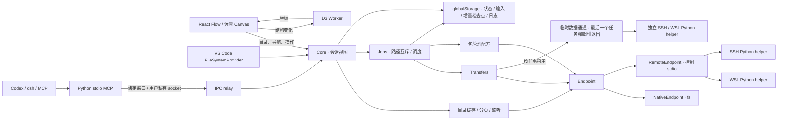
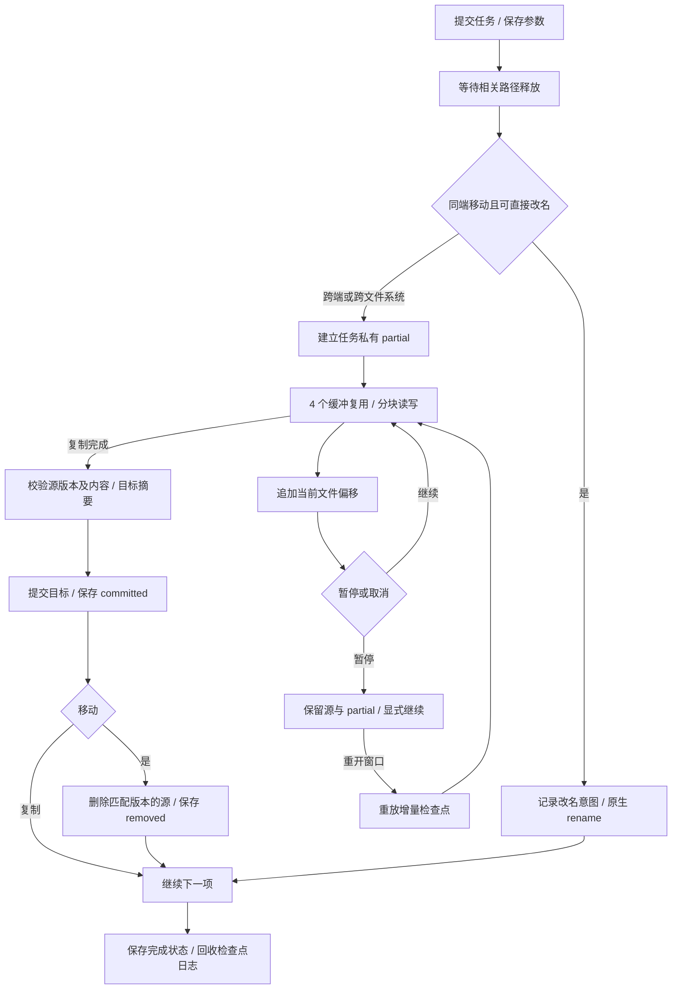

# Workspace Map 代码与数据流

Windows UI Extension Host 持有 Core；磁盘读写使用 Node 原生文件接口。WSL 和 SSH 使用按连接启动的 Python stdio 助手；SSH 连接可复用所选 WSL 环境的 OpenSSH 配置。产品代码以端点配置提供主机、账号和根路径。

- `src/core/core.ts` 是界面和 Agent 的公共入口；视图、跟随、导航历史由这里维护。目录、任务及 UI 的状态通知独立。
- `src/core/directories.ts` 保存有界的已知结构，画布游标独立于 Agent／编辑器。收起释放画布游标；缓存保留时间戳。监听只覆盖可见分支和编辑器保留的目录。画布可见性由 Extension Host 维护；隐藏后迟到的 watch 消息继续受可见性约束，编辑器监听独立保留。分页回复交回之前核对请求归属，已收起或被替换的请求关闭游标。
- `src/adapters/native.ts` 与 `helpers/endpoint.py` 保留文件、目录、链接、特殊节点、无权限结果的身份。游标包含页序号，重复读取最近一页返回同页；客户端之间的扫描相互独立。
- `src/core/jobs.ts` 持有任务生命周期与重叠路径互斥。参数一次写入，检查点按变更键追加；状态文件原子替换。旧版整份任务记录仍可读取。
- `src/packages/` 将具体生态能力转成 argv。包命令的 stdin 与助手协议隔离；输出、取消、退出状态由执行端管理。Windows 命令包装器通过 cross-spawn 处理。
- `src/ui/` 在结构变化时请求布局；任务进度、镜头移动使用各自更新通道。缩小至远景后切换 Canvas，放大恢复完整文件控件。文件手柄与画布平移分别处理。
- `src/mcp/` 负责窗口会话、IPC 与配置接入。MCP 交接任务 ID，计算与传输继续在 Core 执行。

## 复制、移动与恢复

文件内容校验与源删除分开记录。已提交目标的移动在恢复时重新核对目标，保留发生变化的源。原生改名完成但确认中断时，以文件身份核对目的位置。目录同名覆盖采用合并；额外目标条目保留。覆盖／跳过策略锁定具体目标路径，互不重叠的文件可以并行；自动改名仍持有目标目录锁，覆盖其可能选择的同级名称。路径错误、离线、包命令失败由对应任务或分支呈现，画布继续接受操作。

关闭窗口先保存任务状态、停止监听，再关闭助手。旧连接退出事件只处理该连接的请求；已断开的对象拒绝后续调用，重新连接创建新对象。包进程拥有独立进程组，取消后收集实际退出结果。目录和操作权限始终来自端点账号。

## Profiling 的归属

Extension Host 的 CPU／RSS 是共享进程数据，日志显式标记 `shared-extension-host`；插件自身基准另外记录进程差值。Webview 记录 JS heap、长任务、布局耗时，验收通过 CDP 测渲染进程 CPU、DOM 和帧间隔。远端记录助手自身 RSS、峰值、CPU 时间及游标／子进程数。原始数据与条件见 PERFORMANCE。

目录失效立即清除数据缓存，在 150ms 固定窗口内按分支合并通知；读取中收到的刷新请求在当前读取结束后补一次，收起的分支释放该刷新。原生目录属性每批并发 16 项；原生游标空闲 120 秒后由活动游标维护定时器清理，游标归零后停止定时器。画布离屏缓存同时限制为 128 个分支、16,000 条目录项，当前可见分支继续保留。

`map_diagnostics` 读取内存计数，独立于文件扫描；SSH／WSL 的 `map_resources.transport` 记录控制通道的序列化、解析、发送／接收字节、RPC 累计耗时及待处理数量；`transfer` 返回活动数据助手资源，`lastTransferTransport` 保留刚关闭的数据通道计数。RPC 累计时间包含并行等待，用于分析调用开销；报告中的任务墙钟时间另外记录。包进程资源按 helper 管理的直接子进程采样，Linux 返回 PID、RSS 和 CPU；Windows 返回 PID 与退出状态，由验收进程采样器补充进程资源。

文件传输通过 `Endpoint.openTransfer()` 租用数据通道，同一端点的并行任务共享该通道；每个任务在 `finally` 释放租约，计数归零后助手退出。目录、编辑器和包任务继续使用控制通道。端内移动优先保留原有直接改名路径；跨端传输及复制使用独立数据通道。断开端点会同时关闭两条通道。默认两个并行传输任务，各端的数据助手按需启动；空闲端点维持原有控制连接。

单目录中已枚举为普通文件且大小至多 256 KiB 的条目，最多四个并行处理。目录、链接、大文件以及恢复的旧清单沿顺序路径处理；目标别名冲突先排空当前批次。任务共用四块 1 MiB 缓冲，分块读写结束即归还；每个文件继续独立校验与记录提交进度。批次失败等待已启动项收束，完成项留在任务记录中。
