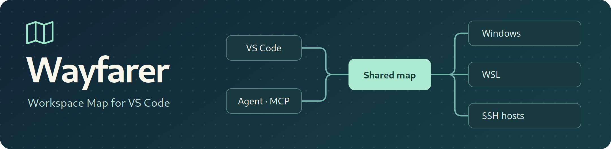
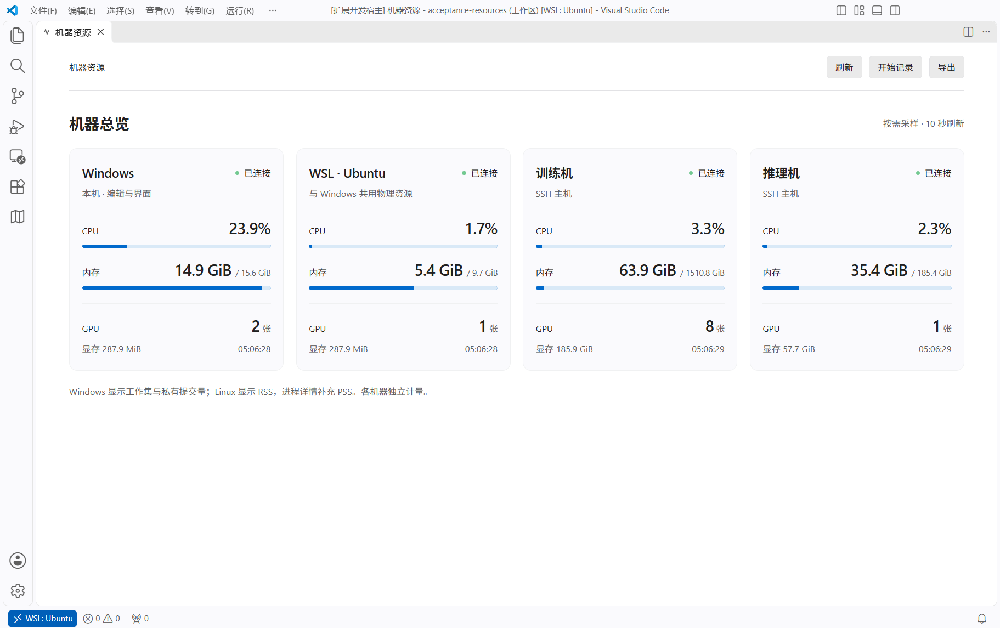
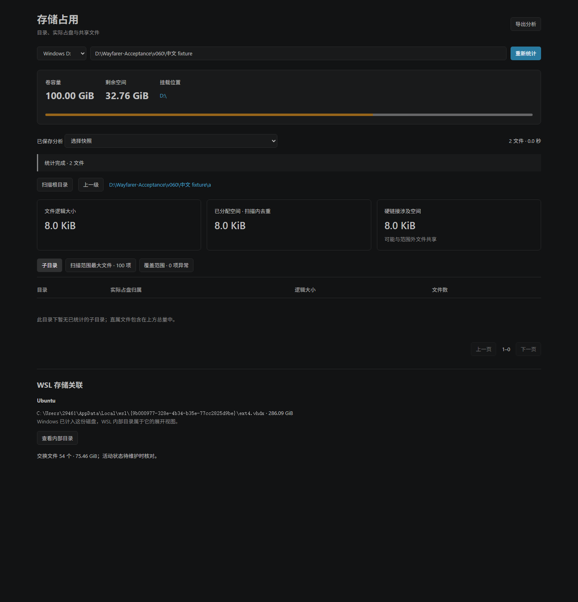

<h1 align="center">Wayfarer</h1>

<p align="center">
  一个行路人，手里握着一张不断生长的手绘地图。<br>
  上面画着来路与去路，画着人能去的地方，和 Agent 能替人走的路。<br>
  所有路汇在一起，成了一条可以回家的路。
</p>

<p align="center">
  从一块屏幕望向另一块屏幕，中间隔着的是同一片可以自由穿行的原野。<br>
  风从一台机器的窗口吹进另一台，<br>
  带着你未写完的代码，和 Agent 刚读到的、某个遥远目录里沉睡的实验记录。
</p>

<p align="center">
  你走到哪里，哪里就是桌面。<br>
  你停下，整片原野便轻轻收拢，像黄昏收拢所有劳作的身影，<br>
  把未完成的事，交给还在醒着的进程。
</p>

<p align="center"><strong>一张轻量的 VS Code 工作区地图，连接 Windows、WSL、SSH，以及与你并肩工作的 Agent。</strong></p>

<p align="center">
  <a href="https://github.com/jiale-li-orion/Wayfarer/releases/latest"><b>下载 VSIX</b></a> ·
  <a href="#轻量运行与性能实测">性能实测</a> ·
  <a href="#快速开始">快速开始</a> ·
  <a href="#与-agent-共用地图">接入 Agent</a> ·
  <a href="docs/MODEL_ANALYSIS.md">模型分析</a> ·
  <a href="CHANGELOG.md">版本记录</a>
</p>



Wayfarer 在 VS Code 中的扩展名是 **Workspace Map**。你可以从 Windows 窗口打开训练机上的源文件，让 Codex 在同一目录查找实验记录，再从侧边栏查看远端 GPU、磁盘余量和传输进度。编辑、文件操作和 Agent 查询都使用所选机器的路径与账号权限。

## 轻量运行与性能实测

展开目录时，Wayfarer 才分页读取这一层。切回编辑器后，隐藏的画布会释放目录监听。跨机复制有独立的数据通道，传大文件时仍可浏览目录。下面是三个实际工作场景的历史验收结果。

| 工作场景 | 实测表现 |
| --- | --- |
| 四端连接，回到编辑器写代码 | **画布监听、游标、待处理读取和轮询定时器均为 0**。0.1.1 验收中，切到空白页签采样 10 分钟，40 次采样均如此。共享扩展宿主在稳定阶段约占单核 CPU 的 **0.046%**。 |
| 扫描百万文件，查看磁盘占用 | **3.30 秒，峰值 RSS 26.19 MiB**。0.6.0 在训练机扫描 1,000 个目录中的 100 万个空文件。耗时和内存对应独立元数据采集器。 |
| 在两台训练机之间搬运数据 | **1 GiB 直传中位耗时 6.44 秒**。0.9.0 的三轮私网实测均计入准备、传输、整文件校验和提交。数据直接在两台服务器之间流动。 |

[测试环境、对照数据与测量口径](PERFORMANCE.md)

## 能用它做什么

| 工作场景 | 在 Wayfarer 里怎么做 |
| --- | --- |
| **浏览和编辑远端项目** | 在目录画布展开 Windows、WSL 或 SSH 节点，双击目录进入子树，在 VS Code 编辑器里打开文件。将常用目录、文件或多根工作区加入收藏。 [项目与收藏](docs/PROJECT_ENVIRONMENTS.md) |
| **在机器之间搬文件** | 用文件手柄拖到目标目录，任务面板显示进度、校验和暂停位置。已授权的 SSH 机器对可通过私网直传大文件；网络恢复后可接着传。 [传输与恢复](docs/OPERATIONS_AND_TRANSFER.md) |
| **管理项目环境** | 在项目目录查看清单、锁文件、解释器和工具路径。Python 默认用 uv；Node、JDK、Gradle、Flutter、Android SDK、Rust 和 winget 按端点查询。执行包操作前可看见实际机器、目录和命令。 [工具与环境](docs/PROJECT_ENVIRONMENTS.md) |
| **巡检机器，找出资源热点** | 目录地图上每台机器直接显示 CPU、可用内存、逐卡利用率和可用显存，以及关注磁盘的余量。点两台 SSH 主机的配对图标查看私网链路。选中进程、传输任务或运行记录，再看资源归属和阶段耗时。 [机器资源](docs/SYSTEM_RESOURCES.md) · [多机性能](docs/MULTI_MACHINE_PERFORMANCE.md) |
| **查清磁盘空间去了哪里** | 对指定目录发起扫描，按占用下钻，查看最大文件、硬链接与实际占盘。对比同一根目录的两次快照，分清目录增长与卷余量变化。 [存储分析](docs/STORAGE.md) |
| **跟踪实验和外部作业** | 脚本或 Agent 可显式登记运行，也能从进程详情手动加入。按阶段查看相关传输，直接打开报告、日志和产物。取消关注时外部工作继续执行。 [作业与接口](docs/WORKLOADS.md) |
| **回放一次模型更新** | 选择训练端的实验记录，沿 optimizer step 查看参与的 microbatch、样本损失、裁剪前后梯度和有效参数变化。固定样本可跨 checkpoint 比较输出，有播放录音时可 A/B 试听。 [记录格式与 MCP](docs/MODEL_ANALYSIS.md) |

<table>
  <tr>
    <td width="50%"><a href="docs/images/resources/01-overview.png"></a></td>
    <td width="50%"><a href="docs/images/storage-060/02-storage-directory.png"></a></td>
  </tr>
  <tr><td align="center">多端资源总览</td><td align="center">目录占用下钻</td></tr>
</table>

### 从一次 LoRA 更新看模型分析

在 CPU 验收用的小型 LoRA 模型里，连续两次更新都累积了四个 microbatch。第一次，B 的梯度范数从 **4.33** 裁剪到 **1.00**，学习率为 **0**，有效权重变化也是 **0**。第二次，学习率升到 **0.005**，同一模块的有效权重变化达到底座范数的 **1.77%**。展开一个 microbatch 的样本，用各自的损失分子、权重和与模式权重，就能复算该批次的 loss。 [查看这次更新的完整界面](docs/images/readme/model-replay.png)

实验项目产生观测记录；Wayfarer 按需读取。训练中可以跟随最新更新，手动点选后停在该步，稍后重开仍可回放。Agent 用 `map_modelAnalysis` 读同一份记录。 [训练端接入](docs/MODEL_ANALYSIS.md)

## 快速开始

1. 从 [GitHub Releases](https://github.com/jiale-li-orion/Wayfarer/releases/latest) 下载 `workspace-map.vsix`。在 Windows 的 VS Code **扩展 → … → 从 VSIX 安装**中选择它。
2. 点击活动栏的地图图标即可恢复上次目录与视角，也可按 `Ctrl+Alt+M`。Windows 磁盘和 WSL 发行版会自动出现。空白处拖动平移，滚轮缩放；文件旁的手柄用于真实搬移。
3. 要接入服务器，选择 **添加 SSH 连接**，输入 `user@host`，在终端确认主机、登录并为机器命名。也可以从 **诊断与接入 → 导入已有 SSH 配置** 加入现有主机。 [SSH 配置与权限](docs/SSH.md)
4. 点机器的可用内存查看进程，点 GPU 卡格查看该卡。进程可以「加入作业」并选定项目；运行直接显示在目录旁，旧记录归在机器下。只有一份报告时，点击实验名直接打开，旁边的「⋯」查看日志与产物。

Windows 删除进入回收站，WSL 和 Linux SSH 删除为永久删除。跨端移动在目标内容校验和提交后处理源文件。编辑器读取上限为 64 MiB，更大的文件可以通过传输任务处理。 [安装、升级与回退](docs/RELEASE.md)

## 与 Agent 共用地图

执行 **接入 Codex** 或 **接入 dsh**；其他 MCP 客户端可从侧边栏的 **诊断与接入 → MCP 配置** 取得启动配置。每个 VS Code 窗口有自己的 `mapId`。Agent 绑定后，你们能看到同一个目录、同一个后台任务或同一条实验记录。需要对齐视角时打开「跟随 Agent」，手动导航即可接管。

可以直接从一个只读问题开始：

> 看一下我当前地图里选中的训练更新。列出参与的 microbatch，再告诉我 q_proj 裁剪后的 B 梯度和这一步实际改变的权重范数。

| Agent 要取得的信息 | 工具 |
| --- | --- |
| 当前绑定的地图、连接状态 | `map_connection`、`map_sessions` |
| 项目标记、环境与工具清单 | `map_inspect`、`map_inventory` |
| 巡检组、机器资源与卷占用排名 | `map_patrolGroups`、`map_systemResources`、`map_storageResult` |
| 已登记的训练、推理、评测 | `map_workloadsPage`、`map_workloadDetail`、`map_workloadRegister` |
| 后台任务、传输进度与控制 | `map_jobsPage`、`map_job`、`map_jobControl` |
| 作业阶段耗时、选中更新的科学记录 | `map_runProfile`、`map_modelAnalysis` |

## 开发与验收

使用 Node.js 22 和 npm 构建。Windows UI 扩展宿主连接 WSL 和 Linux／POSIX SSH 端点，远端助手使用 Python 3.6+。画布布局在 Web Worker 中计算，后台任务由任务系统独立调度。

```sh
npm ci
npm run typecheck
npm test              # Linux；Windows 使用 npm run test:portable
npm run package       # artifacts/workspace-map.vsix
```

[架构与数据流](ARCHITECTURE.md) · [性能实测](PERFORMANCE.md) · [实机验收范围](docs/ACCEPTANCE.md) · [构建发布](docs/RELEASE.md) · [MCP 工具定义](helpers/tools.json) · [许可证](LICENSE)


