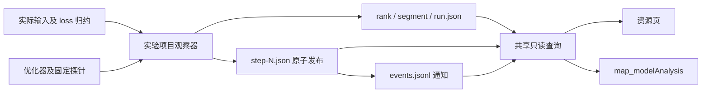

# 模型分析

已登记实验从「作业」直接打开模型记录；独立文件可从「更多 → 打开其他模型记录」选择 run.json。同一次启动的每个 rank 有自己的 segment。选中更新编号会固定游标，勾选「跟随最新更新」恢复实时查看。样本表按 microbatch 分组，样本损失和整个更新的梯度使用各自的统计单位。模块热力图显示实验端实际采样到的值。点击声音时读取选中的音频，打开源码前核对 SHA-256。

训练项目负责采样、损失归约、任务标签和评测。记录保存在实验所在端点。插件与 MCP 通过相同的只读目录接口读取已发布的记录。

| 读取方式 | 返回 |
| --- | --- |
| 空参数 | 当前地图选中的 run、更新及样本／模块 |
| ref + view=run | 实验版本、声明配方、实际参数与源码身份 |
| ref + view=events + cursor | 自字节游标以来的完整 UTF-8 JSON 行，下一页游标 |
| ref + view=step + attempt | 各 microbatch、样本、实际分母、梯度及参数差。sample 和 module 可筛选 |

目录协议为 `wayfarer.model/1`。run.json 包含 runId、rank、segment。每个更新详情带相同身份和 attempt，先完成原子替换，再发布 step 通知。events.jsonl 只追加，尾部未完成的一行留给下次查询。不同进程启动使用独立 segment。查询上限为定义 64 KiB、每次事件 64 KiB、单步 1 MiB。大 tensor 用实验端路径引用。页面保留最近 120 条事件，手动输入尝试编号可读更早的更新。可见页面串行读取；关闭或隐藏会停止轮询。单次试听上限为 16 MiB。

生产者可提供任意模型的记录。参考客户端展示分子、实际权重和、模式权重、样本监督位置、采样模块的累计与单步有效更新；缺测显示空值。训练主机时钟与设备计算时间分别标注。教学样本的 logits 差用于对照输出，任务能力变化由同一独立评测集的结果衡量。

独立评测由实验端发布 type=behavior 的清单与 behavior.json。view=behavior 返回同一评价集上的命中分子、分母和最多 32 个固定样本的两版输出；sample 可定位其中一条。已有软件播放录音的项目可发布 A/B 音频及实际时钟口径。
