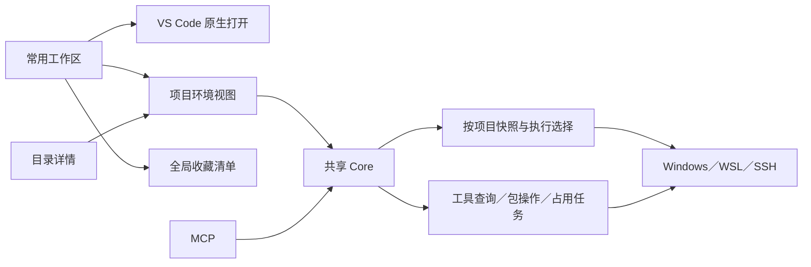
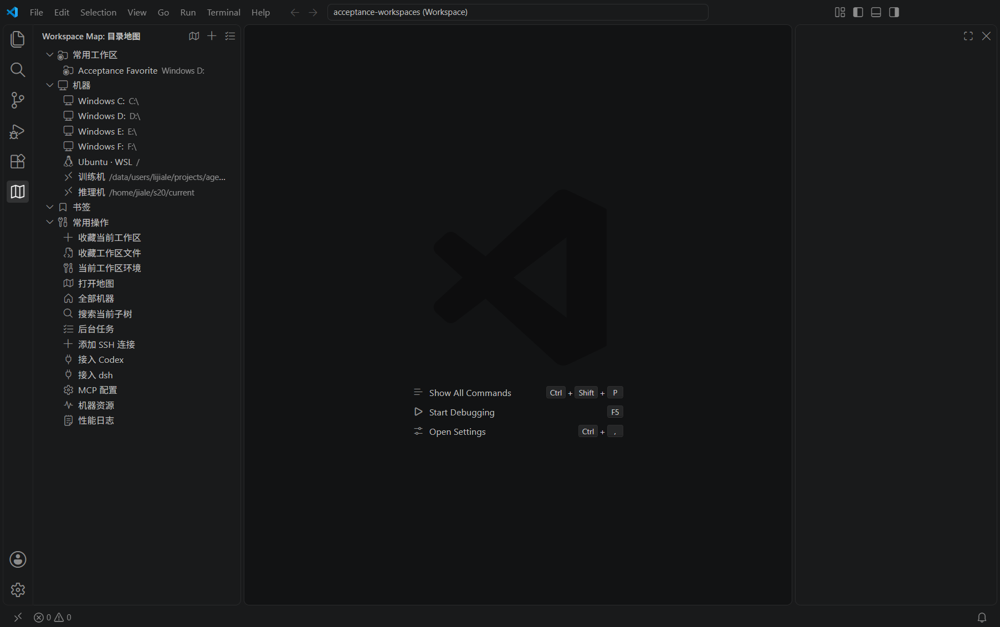
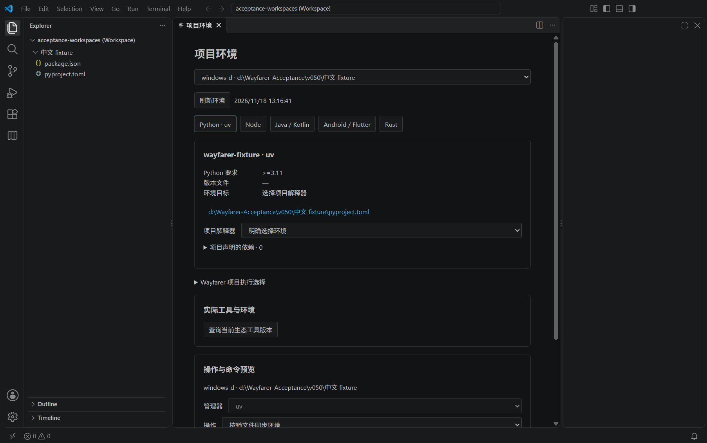
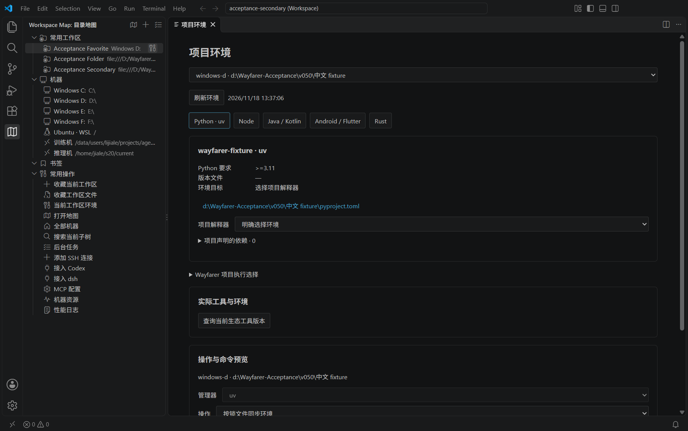

# 常用工作区与项目环境

## 工作区入口

侧边栏“常用工作区”收藏原生目录或 `.code-workspace`。点击沿 VS Code 原生打开；右键提供新窗口打开、加入当前工作区、地图定位、环境查看、绑定 Remote、重命名、排序和移除。常用操作提供收藏当前工作区、收藏文件及查看当前工作区环境。地图目录详情提供收藏与环境入口，已登记项目可从收藏命令中选择。

收藏清单位于插件 `globalStorage/workspaces.json`，各窗口读同一份元数据；短文件锁保护跨窗口更新，临时文件原子替换。侧边栏可见时监听清单文件，隐藏后释放。地图、任务和 Agent 仍按各自 `mapId` 保存；收藏和原生打开保持独立。

Windows 目录使用 file URI，WSL 使用对应发行版的原生 Remote URI。SSH 地图可能使用 WSL 内的配置，而 Windows Remote SSH 使用另一份配置，因此第一次原生打开需要绑定已配置的 authority。插件保留 SSH 配置。收藏现有原生 Remote 工作区直接保存其 URI。跨运行环境的目录通过原生窗口或地图访问；“加入当前工作区”限定相同 scheme 与 authority。

原生切换工作区遵循 VS Code 的扩展宿主重启行为。当前工作区再次点击只聚焦。多根工作区首次转换和改变第一个根目录也可能重启；地图浏览与打开普通文件保持在当前窗口。

## 环境与命令

“项目环境”按根目录切换。默认读取固定名称、每份最多 256KiB 的声明；返回 Python 要求、依赖、锁文件、解释器候选，Node 管理器声明与锁文件，以及 JDK／Wrapper 路径。完整清单通过编辑器打开。真实版本查询、已安装包、缓存位置和占用统计由按钮发起，结果标明时间与执行端点。

Python 默认 uv：

- `project-add`／`project-remove` 维护项目声明与锁文件，使用 `--no-sync`；`project-update` 仅更新指定依赖的锁定；`project-sync` 使用 `--locked` 对现有环境同步。
- 项目操作明确设置 `UV_PROJECT_ENVIRONMENT` 和 `UV_PYTHON_DOWNLOADS=never`。默认目标为已有 `.venv`；选择其他虚拟环境时核对解释器及环境标记。
- 独立环境包操作采用 `uv pip`，明确指定解释器；Python 安装清单、uv 工具、缓存分别查询。
- 保存的 Python／uv／Node／Java 选择仅归 Wayfarer 项目操作，VS Code 和终端配置沿原设置。Node 包命令可将指定运行时放在执行 PATH 前端。

执行前显示 argv、cwd、环境目标及来源；修改由“确认执行修改”触发。任务沿现有 Jobs、operationId、日志和取消流程。包操作收束后使相关环境快照失效，重新查看按需更新。其他生态沿既有适配器。

## 数据和资源归属

固定标记及工具路径批量查询，缓存沿既有 64 项／8MiB 上限；同查询合并，变更后失效。项目版本查询只触达当前项目和选中生态。环境面板关闭释放任务订阅；已提交任务独立执行。诊断补充环境面板数、收藏监听器数。

MCP 扩展 `map_inspect(environment:true)`、`map_inventory(ecosystem)`，新增 `map_environmentSelect`、`map_workspaces`、`map_workspaceSave`；旧调用保持原返回约定。原生窗口打开由用户界面操作。

## 验证入口

`tests/environments.test.ts` 覆盖全局清单并发更新、URI 身份、声明解析、环境选择、命令配方与既有环境前置条件。`scripts/verify-uv-project.mjs` 使用隔离 wheel 和虚拟环境验证清单、锁文件、安装与移除的交接；其临时目录在结束时删除。`scripts/profile-environments.mjs` 只连接独立验收窗口，持久记录宿主资源与生命周期计数。四端实机结果和性能数据见 ACCEPTANCE.md 与 PERFORMANCE.md。

## 界面

