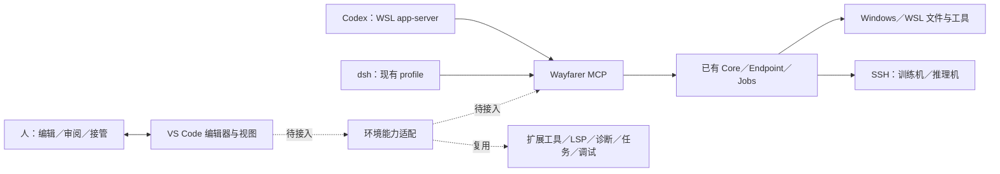

# Codex／dsh 与 VS Code 共享开发环境：方案评审

## 工作方式与当前边界

人和 Agent 面向同一套项目、机器、源码和运行结果。人继续写代码、文档，检查结果、定位和接管；Agent 主要负责运行、构建、测试及性能分析。VS Code 保留编辑与生态界面，Wayfarer 提供跨机器定位、能力入口和任务可见性。

当前实际链路：Windows VS Code UI Extension Host 中的 Wayfarer Core → Windows 原生文件接口／WSL stdio helper → SSH 训练机与推理机。Codex app-server 运行在 WSL，dsh 从本机 profile 接 MCP；已验证的本次 shell 与 WSL 扩展宿主共享挂载和 PID 命名空间。文件已经能够共享，编辑器缓冲区和工具服务还需接入。

当前 MCP 提供目录、文件、视图、任务、包、环境盘点和资源查询。文件读取面向端点磁盘，未保存的 TextDocument 内容尚未交给 Agent；当前公共接口也未提供定义、引用、诊断、测试或调试调用。`map_diagnostics` 是地图自身资源状态。

## 仓库与语言服务

通过 gh CLI 核对近期有写权限的仓库、语言构成、构建清单及部分署名提交；语言字节量用于识别项目组成，服务优先级结合实际任务和未来方向。

| 工作集 | 实际仓库依据 | 语言服务安排 |
|---|---|---|
| 模型、推理、数据、实验 | inference-service 约 98.8% Python；GPU-serving-lab、SecFusionAgent、语音研究 | VS Code 复用 Python／Pylance；独立语言服务评审 Pyright，遵守各自运行与许可边界 |
| 前端、Agent 工具、平台 | Wayfarer 约 75.4% TypeScript；React／Taro 小程序、研究后台及 Electron | 复用内置 TypeScript／JavaScript、HTML／CSS／JSON；按项目读取 tsconfig 和锁文件 |
| 业务后端 | research、wuwangwo-new、tech-platform 的 Java | JDT Language Server，绑定实际 JDK／Maven／Gradle；控制项目导入范围 |
| Android／Compose | research 约 29.5% Kotlin，Android 与 Feiyu 项目 | 官方 Kotlin LSP 单独验证 Java 互操作、Compose 和 Android 导入；Android Gradle 支持仍属实验性 |
| GPU／系统代码 | GPU-serving-lab 已有 CUDA，seekdb 为大型 C++ 系统阅读对象 | 保留现有 C/C++ 服务，专项评审 clangd 与编译数据库；同一项目只启用选定的语义提供者 |
| Flutter 客户端 | dsh-Go 约 75.2% Dart，Ming-Palace | Dart Analysis Server／Flutter，按项目启动 |
| 未来服务组件 | 用户计划采用 Go／Rust | 分别使用 gopls／rust-analyzer，实际模块出现后按项目接入 |
| 部署、文档 | Shell、YAML、Markdown、Typst 等 | 复用已有语法、校验和预览，运行继续沿端点工具链 |

Omni 语音模型、自然交互 Agent 与临床交互 Agent 的研究还需要 PyTorch／Triton、实验、GPU 和数据链路的 profiling。这些属于运行能力，和语言服务分别登记；编辑器资源采样与模型 workload 测速分别归属。

## 现有生态可以直接复用的部分

安装清单已经声明 6 个 Python 环境相关工具、8 个 C/C++ DevTools 工具及 1 个 C/C++ 配置工具。首次打开本地窗口时，探针可以列出其中的环境／构建／符号工具；进入实际 WSL 工作区后，这些工具未出现在当前工具目录。Python、C/C++ 扩展安装于 Windows，当前 WSL 第三方清单主要是 Agent 和文档插件，服务宿主位置是一个实际缺口。例子包括 Python 环境／解释器查询，CMake 构建与测试，符号引用、信息、调用层次查询。注册声明、当前窗口可用和真实调用成功分别核验。

| 能力 | 提供者与入口 | harness 接入方式 | 人看到的结果 |
|---|---|---|---|
| 已有扩展工具 | `vscode.lm.tools`／`vscode.lm.invokeTool` | 从选定工具建立 MCP 适配，保留参数和结果语义 | 对应项目、工具、结果和任务状态 |
| 定义／引用／符号 | 现有语言提供者与 `vscode.execute*Provider` | 端点／项目／URI／位置路由，返回结构化位置 | 编辑器定位与可审阅结果 |
| 编辑器上下文 | TextDocument、活动编辑器、选区 | 返回缓冲区内容来源、版本、dirty 状态及范围 | 与人当前编辑内容一致 |
| 诊断 | `vscode.languages.getDiagnostics` 与诊断事件 | 返回服务当前观察结果、来源和时间，区分未就绪与空结果 | Problems 与文件定位 |
| 修改 | WorkspaceEdit 与版本信息 | 生成修改集，应用前对照当前文档版本，沿 harness 既有修改策略 | diff、编辑器修改及撤销 |
| 构建／测试 | 现有 CLI、VS Code Task、扩展工具 | 优先已有可靠 CLI；复用项目模型和结构化结果带来增益的扩展入口 | 终端、任务、失败定位 |
| 调试 | Debug Adapter／VS Code Debug API | 由 Agent 发起，调试会话、栈、变量和断点各有归属 | 原生调试视图可观察与接管 |
| 项目／Git | 已有 Git、worktree、PR 工具 | 项目身份与分支状态、已有入口和 CLI | Git 图、diff、PR、地图定位 |

VS Code 的 Language Model Tools API 是可复用的工具机制；逐项验证停用 Copilot 业务入口后的可用性。工具确实依赖其他组件时标明依赖，再选择复用公开命令、标准协议或原 CLI。

## Codex 已有的 LSP MCP：优先复用的实际入口

本机 Windows Codex 26.1111.21308 与 WSL Codex 26.1007.21434 均包含 `chatgpt.showLspMcpCliArgs` 命令和默认关闭的 `useExperimentalLspMcpServer` 分支。已安装源码中，WSL 实现创建临时 Unix domain socket，内置 Codex 可执行文件通过 `stdio-to-uds` 提供 stdio MCP 客户端入口，服务随扩展生命周期清理。静态工具列表是 `vscodeDiagnostics`、`vscodeReferences`、`vscodeWorkspaceSymbols`。

这条既有链路应先验证复用。Codex 可沿内置配置接入，dsh 可评审接入同一个 stdio MCP 入口；稳定项目／窗口绑定由现有地图注册机制衔接，日常配置中避免固定临时 socket 路径。它目前只覆盖三项查询；未保存内容、跨端 URI、受控修改以及外部扩展工具仍分别评审。

上述实验入口已完成源码追踪，本轮保持关闭。官方公开设置文档尚未承诺这一实验项的稳定契约，下一轮先在隔离窗口验证重载、取消、dsh 消费和权限，再决定正式启用。本轮不升级两端 Codex，也不更改账号、模型和权限设置。

## 本轮独立窗口的可行性验证

- 相同 WSL 项目与临时 TypeScript fixture，12 轮查询／缓冲区修改中，语言服务预热后每轮返回 1 个定义、2 个引用；修改仅作用于 fixture 并恢复原文保存。首次返回空结果与服务初始化时间单列。
- 停用 Copilot 业务入口后，公共 Language Model Tool API 仍列出 21 项工具；通过 `vscode.lm.invokeTool` 调用既有 `vscode_listCodeUsages`，约 41ms 返回 2 个测试符号位置。此调用未请求模型推理。
- 未启用 Codex 的实验 LSP MCP，也未新增 Wayfarer 公共接口。以上分别证明现有语言服务和工具调用路线可复用，harness 接线保留在下一阶段。
- Windows 与 WSL 的 Codex 安装保留；现有 Codex 主对话和地图 MCP 读取继续可用。dsh headless CLI 启动检查通过，本轮未发起额外 dsh 模型请求。实际 profile 的能力注册与稳定绑定列入下一阶段。

## 最小接入边界与数据流

保留现有 Core 的端点、路径与任务归属。VS Code 相关适配放在 Extension Host 层，Core 和 SSH helper 继续服务已有文件与后台任务。MCP 负责将允许接入的能力提供给 Codex／dsh；优先核对已有 Codex LSP MCP 的覆盖，再补公共扩展工具与必要上下文适配。当前阶段只评审，公共接口保持现状。

建议首个闭环采用 TypeScript：同一项目中，人打开并修改一段尚未保存的代码 → Agent 获取缓冲区版本与内容 → 查询定义、引用和现有诊断 → 返回修改集 → 应用时核对版本 → Agent 通过既有命令运行检查 → 人在编辑器和终端查看结果。

拟新增接口按三组评审：环境／能力发现，文档／语义查询，受控修改／运行任务。继续使用现有 mapId、端点 Ref、任务 ID 和订阅机制；每个接口明确服务宿主、项目和数据版本。动态工具目录只展示选定项目需要的能力，避免每个插件的全部命令常驻到上下文。

语义服务在能读取该项目源码、依赖和配置的宿主运行。文件地图允许多机器同屏；语言服务就绪情况独立展示。服务尚未启动时按用户／Agent 的明确请求启动，报告实际状态；多个窗口和 Agent 优先复用已有提供者。任意执行 VS Code 命令不作为公开工具入口。

## 生命周期、权限与性能

- Agent 原有 shell、搜索和文件工具继续按任务使用。跨环境操作明确端点与 cwd，语言查询使用对应项目和 URI。
- 编辑器缓冲区版本与磁盘版本分别记录；人修改后旧结果保留原版本标识，应用修改时检查实际版本。
- LSP 初始化、项目导入、诊断产生、后台命令分别计时；返回已有诊断的观察时间，后续更新沿事件送达。
- 客户端解绑释放自己的订阅和等待器。由编辑器／语言扩展管理的共享服务沿其生命周期；由具体后台任务启动的进程按任务取消与归属释放。
- 权限沿现有端点、工作区信任与 harness 策略。读取、修改和运行能力分别登记；既有确认流程继续由原实现承接。
- 记录路由、激活、排队、工具执行、语言初始化、序列化和响应时间。资源采样展示宿主与进程归属，关闭面板停止对应订阅。

## 实施评审门槛

完成本轮插件精简和相同场景的资源对照后，评审一个 TypeScript 共享环境闭环。须验证：真实工具注册与调用、未保存缓冲区、URI／端点映射、诊断来源、人并发编辑、取消与重载，以及 Codex／dsh 的实际消费方式。Python 环境工具作为第二个适配用例。Java／Kotlin、GPU／C++、Dart、Go／Rust按各自项目验证后扩展。

本轮交付方案、资源与生态清单，下一轮再实施所选接口。

## 核对来源

- 仓库：wuwangwoad/research、wuwangwo-new、tech-platform、inference-service、frontend；jiale-li-orion/Wayfarer、dsh-meshfin、dsh-Go、GPU-serving-lab、SecFusionAgent、seekdb、sounex.ai、voice-memory-research。
- 本地实现：src/extension.ts、src/mcp/、src/core/、helpers/tools.json。
- [Codex IDE settings](https://learn.chatgpt.com/docs/ide/settings)、[Codex MCP](https://learn.chatgpt.com/docs/extend/mcp?surface=cli)；实验入口的实现事实来自本机已安装包，未把其视为官方稳定承诺。
- [VS Code Language Model Tool API](https://code.visualstudio.com/api/extension-guides/ai/tools)、[API reference](https://code.visualstudio.com/api/references/vscode-api#lm)。
- [Remote extensions](https://code.visualstudio.com/api/advanced-topics/remote-extensions)、[Virtual workspaces](https://code.visualstudio.com/api/extension-guides/virtual-workspaces)。
- [Kotlin LSP](https://kotlinlang.org/docs/kotlin-lsp.html)、[gopls](https://go.dev/gopls/)、[rust-analyzer](https://rust-analyzer.github.io/book/vs_code.html)、[clangd compile commands](https://clangd.llvm.org/design/compile-commands)。

## 轻量运行的归属

Windows 承担编辑器、Webview、GPU 和 UI 扩展宿主，WSL 承担远端扩展宿主、Agent、语言服务与端点助手。[实际双端采样](WINDOWS_WSL_RESOURCE_AUDIT.md)发现渲染开销高于 Windows 本地扩展宿主，资源治理据此分层：能力目录按需读取；语言服务绑定选定项目；Webview 隐藏时释放渲染上下文并恢复持久视图；构建进程随任务管理。保留工具安装与调用入口，启动和释放由实际项目／任务负责。

Wayfarer 后续环境能力视图同时标明 Windows／WSL／SSH、提供者、PID、项目、CPU 时间和内存口径，先复用现有实例再启动新实例。Agent 任务状态与编辑器面板独立，关闭面板释放页面订阅，任务继续受 Core 管理。逐页渲染优化需要在可控窗口记录目标页面和相同操作；当前采样为日常活跃窗口的定位依据。
