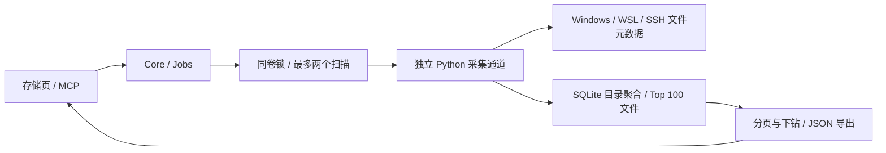

# 存储分析（0.6.0）

侧边栏与机器资源页进入存储页面，目录详情的统计按钮进入同一页面。扫描、结果查询和维护各有入口。页面按需读取卷容量，开始统计才遍历目录；隐藏页面释放 UI 订阅，后台扫描继续归 Jobs 管理。

Windows 文件身份来自实际 stat，分配空间来自 GetCompressedFileSizeW；DirEntry 缓存的设备号与链接数在 Windows 上不足以承接去重。Linux 读取 inode、device、nlink 和 st_blocks，并累加可读取的目录数据块。Windows 目录索引和两端文件系统元数据由卷总量承接，文件树统计显式保留此口径。软链接、重解析点及跨卷入口跳过并计数。目录扫描期间改变、权限与分配空间缺失分别保留覆盖状态。

逻辑字节按目录项统计；已分配字节按文件身份在扫描范围内归属一次。硬链接目录项涉及字节可能重复；范围外仍有链接的文件从根目录回收上界中扣除。分配空间未知时回收上界为未知。压缩与共享区段、并发修改及文件系统元数据使估计和清理后的卷余量变化有所区别。

本机扫描直接写 globalStorage 下的 SQLite 索引。远端扫描在权限受限的私有临时目录维护工作索引，通过分页 RPC 把目录聚合写回本机；最后关闭通道并删除远端临时目录。SQLite 缓存限制 2 MiB，最大文件堆限制 100 条。完整文件清单留在扫描端的系统枚举器与硬链接工作索引中，界面只读当前页。相同卷串行、不同卷最多两个；浏览、传输继续沿原通道和调度。

快照由 globalStorage/storage-scans 持有，完成或取消后保留聚合、错误与时间。最多保留三份、总量 100 MiB，旧快照查询明确返回已过期。对已打开快照的查询租约结束后才可回收。采集器按 UTF-8 读取协议，输出使用 ASCII JSON 转义以兼容 Windows 系统编码。协议损坏会立即拒绝该通道的待处理请求并结束所属进程。窗口退出先收束任务 finally，再释放存储通道；宽限结束中止所属进程。

## 接口

- map_storageProbe(ref)：卷容量、身份、Windows 注册的 WSL 系统盘与交换文件；活动状态保留 unknown。
- map_storageScan(ref, operationId?)：返回持久任务收据，取消沿 map_jobControl。
- map_storageResult(id, directory?, offset?, limit?)：目录聚合、当前子目录页、扫描范围 Top 100、覆盖范围。默认每页 50，最多 200。
- map_storageSnapshots()：读取已保留快照的元数据。
- map_job(fields?)：可选 summary/result/errors/logs；summary 查询直接读取任务元数据。
- map_listClose(ref, cursor)：仅释放当前客户端拥有的游标。

原 map_size 和省略 fields 的 map_job 保持兼容。WSL 虚拟文件系统容量与 Windows 承载卷余量分别返回、分别展示；两个入口使用同一承载卷扫描锁，虚拟剩余空间不代表承载盘可继续写入的大小。快照同时保留承载关系和采样时间。

Windows 普通删除仍进入回收站，任务日志保留其语义；永久清理与 WSL 离线维护由明确操作发起。

## WSL 维护

独立Windows维护入口默认生成文件身份预览；显式执行时在WSL停机后取得独占句柄，核对同一文件对象并回收选定旧交换文件。现役目标存在且配置一致时支持重跑；Get-DiskImage保留为辅助诊断，身份或独占校验失败时保留文件。入口、退出码与离线步骤统一见 [WSL维护](WSL_MAINTENANCE.md)。

## 0.7.0：容量刷新与快照对比

容量页打开、手动刷新、扫描结束和相关文件／包任务结束触发采样。容量控制器只有一个在途查询；150ms 合并事件，切换目标后丢弃旧结果，隐藏后释放定时器。WSL 与 Windows 盘符按承载关系匹配；包缓存可能写入项目所在卷之外的 Windows 卷，同机包任务结束会刷新当前容量。

`map_storageCompare(before, after, directory?, offset?, limit?)` 对同端点、同根目录的两份保留快照查询直接子目录并集，按已知占盘变化绝对值排序，默认 50、最多 200 条。SQLite 双库连接和磁盘临时表承接计算；响应只保留当前页。返回新增／移除目录、已知占盘和逻辑大小变化、两次覆盖情况，以及单列的承载卷余量变化。目录变化与其他程序造成的卷变化分别展示。对比导出沿用分块写入、原子提交和快照租约。

保留策略继续为三份索引、100 MiB；淘汰后最多保留十二条小型元数据，标明数量、总预算或单份超预算。`map_storageSnapshots(includeUnavailable=true)` 可取这些状态；省略参数沿用仅返回可用索引的行为。查询已淘汰索引返回具体原因。新扫描前可导出当前结果。
