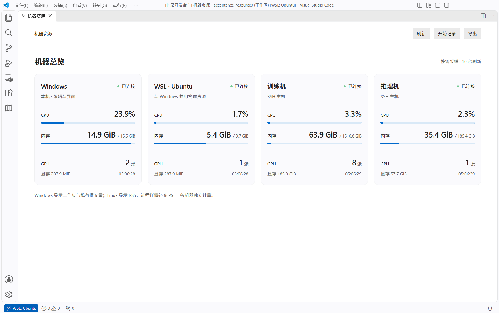
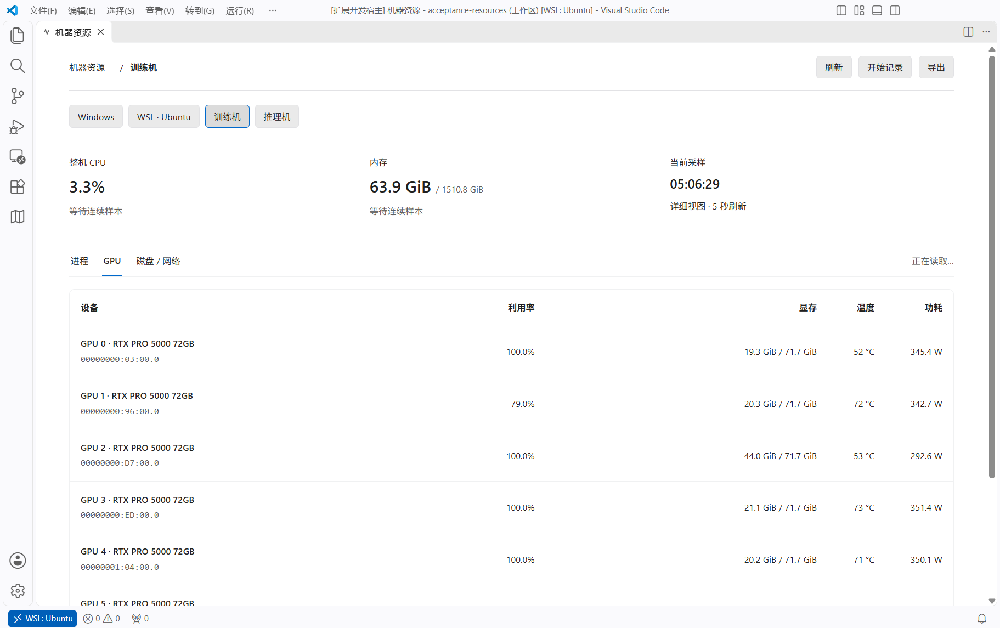
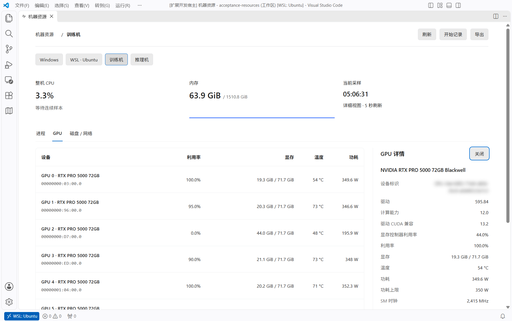

# 四端资源视图 · 0.4.0

0.12.0 的日常入口是目录地图。点内存打开进程，点 GPU 查看设备与关联进程，点磁盘查看目录占用。下文中的独立资源页截图和 verify-resources 脚本记录先前版本的验收。当前实机脚本是 verify-surface-lifecycle.mjs。


原生活动栏的「常用操作 → 机器资源」打开独立资源页。总览只读取机器摘要；选择机器后按进程、GPU、磁盘／网络页签读取，点击对象再查询详情。界面沿 VS Code 主题，图表使用有界 SVG 折线；目录画布沿原入口运行。

```mermaid
flowchart LR
  Sidebar[原生侧边栏] --> UI[资源页：总览／页签／详情]
  UI -->|可见订阅| Monitor[SystemMonitor：机器合并／串行／快照缓存]
  Agent[Codex／dsh] -->|map_systemResources 单次只读| Monitor
  Monitor --> Record[明确开始的记录：globalStorage JSONL]
  Record --> Export[流式 JSON／CSV 导出]
  Monitor -->|独立 stdio／SSH 通道| Collector[Python 标准库采集器]
  Collector --> Linux[/proc：CPU／内存／进程／磁盘／网络]
  Collector --> Win[WinAPI／DXGI／PDH]
  Collector --> NVML[NVML：GPU 与驱动可见进程]
  Collector -.兼容路径.-> SMI[nvidia-smi]
  Files[目录／编辑器／传输任务] --> Core[原有 Core／Endpoint／Jobs]
```

## 读取与生命周期

每个地图运行实例内，Windows 的多个磁盘端点合并到一个机器目标；相同 SSH 连接参数共用采集器。每台机器一个串行通道，相同请求合并，快照缓存 2 秒。总览每 10 秒刷新，选中页签每 5 秒刷新；慢采样期间界面更新兴趣，旧页签等待请求按当前兴趣跳过。文件读写和传输使用原有控制／数据通道。

资源页隐藏或窗口不可见时撤销该页订阅；最后一个订阅离开且记录停止后，完成在途查询并释放专用采集进程。MCP 单次查询复用快照，完成后释放自己的空闲通道。明确开始的后台记录继续采样，停止后等待写入收束。地图退出沿原 1.5 秒宽限关闭采集通道。CPU／助手日志采样由可见资源页、活动任务和明确记录驱动，空闲时停止旧的固定 15 秒宿主／助手采样。

每机器保留 120 个趋势点／最近 10 分钟、8 份查询缓存。进程按页交付，首屏 50 条；前端虚拟列表只渲染可见行及少量缓冲。进程参数仅在选中 Linux 进程时用于固定工具标记识别，原始参数和环境变量保持在协议数据结构之外；协议、日志与导出只交付名称、角色、路径等明确字段。项目关联依据已登记路径与工作目录，容器 ID 依据进程 cgroup。

Agent 直接读取快照和历史采样，指定文件交付使用 map_artifactExport。记录位于当前 map 的 `globalStorage/<mapId>/resource-recordings/*.jsonl`。JSON／CSV 导出逐行读取，写入队列有界；存储错误结束该次记录并通知资源页。取消保存对话框保留原记录。资源查看遵循当前端点账号权限；受限字段、已退出对象、驱动缺少的指标分别显示当前状态。

## 指标口径与接口

`map_systemResources` 为新增只读工具；`map_resources` 保留原有助手资源语义。省略 endpoint 返回机器目标与已有快照，指定 endpoint 按需采样。section 支持 summary、processes、gpus、io、process、gpu；进程支持 search、sort、offset、limit（默认 50、至多 200），详情使用 pid／identity 或 gpu UUID。

```json
{"endpoint":"train","section":"processes","sort":"rss","offset":0,"limit":50}
```

结果包括采样时间、机器／端点、online／offline 状态、可用指标、采集器累计 CPU 时间与耗时。首个 CPU／吞吐样本显示预热状态；后续使用两个实际采样间的差值。Windows 工作集与 PrivateBytes、Linux RSS 与按选中读取的 PSS 分别展示；整机 CPU 以全部逻辑核为 100%，进程 CPU 以单逻辑核为 100%。WSL 记录虚拟机范围，Windows 与 WSL 中的同一 NVIDIA GPU 保留相同驱动 UUID，跨端数据按归属分别查看。

NVIDIA 优先通过驱动的 NVML 读取 GPU 利用率、显存、温度、功耗／上限、时钟、PCIe 与计算／图形进程。Windows 核显通过 DXGI 与 PDH 读取专用／共享内存和引擎利用率；WDDM 进程显存以可用 PDH 字段补齐。CIM 的 AdapterRAM 为 32 位字段，本轮已实测出现容量截断，显存容量沿 NVML／DXGI 读取。权限与设备能力决定可见字段。

## 复测

`npm run typecheck`、`npm test`、`npm run package` 沿现有入口执行。真实窗口脚本为 `scripts/verify-resources.mjs <输出目录>`，显式指定 WM_SESSION、WM_CDP_PORT，限定 acceptance-resources 测试工作区；默认四端采样 600 秒、50 轮隐藏恢复、隐藏待机 600 秒。采样与生命周期结果分别记账，失败后保留已完成阶段，可用 WM_RESOURCE_RESUME=1 接续生命周期与待机阶段。

实际 CPU／内存、驱动核对及编辑／传输兼容结果记入 PERFORMANCE.md 和 docs/ACCEPTANCE.md。研发在训练机独立工作树，本机验收配置、工具版本和授权策略各自保留。

Windows PDH 按摘要、进程 GPU 内存和磁盘／网络分组收集，切换页签后停止读取未选中的计数器组；差分基线过期后重新预热。Windows 本地脚本使用原生文件对话框和独立临时目录验证导出，采集与文件传输分别记录资源和内容校验结果。

## 实机界面

总览 → 单机 GPU 列表 → GPU 详情。公开截图遮盖设备 UUID。







## 0.7.0：内存压力与有界记录

Windows 提交量改用 GetPerformanceInfo 的 CommitTotal／CommitLimit × PageSize，分页文件大小从固定卷上的实际文件属性取得；磁盘容量单独统计。Linux 增加 `/proc/pressure/memory`、`/proc/vmstat` 的换页／主缺页速率及内核 OOM 终止累计，cgroup 事件注明采集器当前 cgroup。零值、权限缺失与历史累计分别呈现。Windows 采集器缓存 WSL 注册路径，每次只重读承载卷余量；WSL 快照复用十秒内的 Windows 快照取得承载预算。

资源页展示可用物理内存、提交量、swap、PSI、换页及 OOM 计数，并提供进程页定位。提示阈值为物理可用低于 10%、提交比例达到 85%、PSI some avg10 达到 10%、卷余量低于 5%；提示说明测量条件，进程与配置由明确操作管理。Windows 整机、WSL、单进程口径各自标记，WSL 与宿主数字分别观察。

记录每台机器至多每十秒一份，十分钟或 20 MiB 自动结束。达到上限、存储滞后和写入错误均结束对应记录，撤销记录持有的采样兴趣，等待在途请求后释放助手；可见页面保留自己的订阅。`workspaceMap.resourceRecordingDirectory` 可设本机绝对路径，各地图再按存储 ID 隔离；空值沿用 globalStorage。旧记录继续可读取，JSON／CSV 增加压力字段。日常使用验收将该配置指向 D 盘。

计数依据：[GetPerformanceInfo](https://learn.microsoft.com/en-us/windows/win32/api/psapi/nf-psapi-getperformanceinfo)、[PERFORMANCE_INFORMATION](https://learn.microsoft.com/en-us/windows/win32/api/psapi/ns-psapi-performance_information)。

## 0.7.1：受限进程与精简读取

`vmmemWSL` 的原生进程句柄可能受限。进程查询按PID合并PDH的工作集和私有提交量，缺失时再使用CIM，后者在采集器内缓存60秒。来源与实际采样时间进入进程详情、JSON和CSV；权限不足的其他字段继续保持未知。目录浏览、资源总览和空闲状态各自沿原调度运行。

MCP `map_systemResources` 新增可选 `compact:true`，只交付请求的section；例如进程查询仅包含进程分页与状态，省去历史、GPU和卷元数据。默认完整响应保留。`map_list.fields` 可选择name/path/kind/size/mtime/identity/target/error；分页游标与目录缓存保留完整身份。数据投影发生在Core返回边界，资源页和其他消费者继续共用同一快照。
